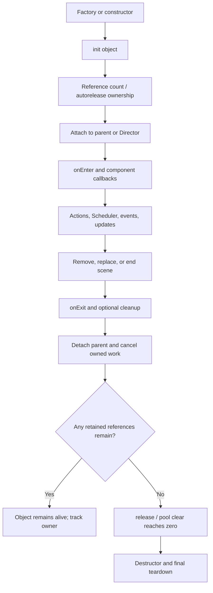

# Cocos2d-x 4.x Scene, Node, and lifetime

Use for scene graph changes, component attachment, callbacks after node removal, leaks, and use-after-free risks. Trace graph membership, running state, cleanup, and C++ ownership as separate facts.

1. Follow construction and initialization (`create`/`init` or the project's factory), parent-child attachment, and Director scene ownership.
2. For add/remove/replace operations, inspect the exact `Node` and `Scene` implementation for parent state, `onEnter`/`onExit`, transition callbacks, cleanup behavior, and child ordering.
3. For destruction questions, trace `Ref` retain/release, autorelease-pool release, parent ownership, component-container references, and any Actions/Scheduler/EventDispatcher registrations. Removing a node from its parent or calling cleanup does not prove its destructor ran.
4. Cocos2d-x 4.0 has `Component` and `ComponentContainer`; check the local implementation for callback order, ownership, enabled state, and update dispatch. Do not assume Creator's component scheduler or serialized scene behavior applies.
5. When changing lifetime-sensitive code, create a focused reproduction and verify construction, attach, detach/cleanup, callback cancellation, and final release on the target. Static source tracing alone must be reported as static evidence.

## Local reference and evidence boundary

Use the [Scene/Node/Component lifecycle trace](../../../../docs/cocos2d-x/02-objects-and-lifecycle.md) and inspect `engine/cocos2d-x-4/cocos/base/CCRef.*`, `CCAutoreleasePool.*`, `cocos/2d/CCNode.*`, `CCScene.*`, and `CCComponent*` as relevant. The current Cocos2d-x lifecycle study is static; the paired HelloCpp demo verifies scene construction and display, not destruction/release callback order.

For a Creator lifecycle comparison or port, consult the [topic comparison](../../../../docs/comparisons/cocos2d-x-4-vs-creator-2.4/03-scene-node-lifecycle.md). Ordinary Cocos2d-x lifetime work does not need that cross-engine reference.
