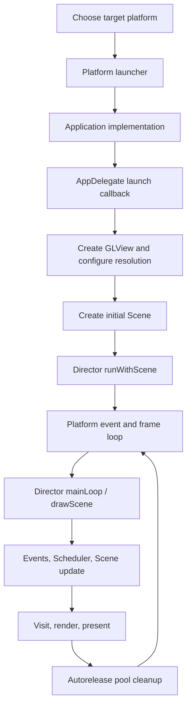

# Cocos2d-x 4.x startup and frame loop

Use for startup failures, first-scene behavior, frame scheduling, or questions about where a Cocos2d-x frame is driven. Establish the platform first; there is no single launcher path shared by all targets.

1. Trace the selected platform launcher into its `Application` implementation and `AppDelegate::applicationDidFinishLaunching()`.
2. Follow `Director` creation, GLView/window setup, design resolution/content scale, first `Scene` creation, and `runWithScene()`.
3. Trace that platform's loop into `Director::mainLoop()`/`drawScene()`: event polling, Scheduler/update phases, pending scene transitions, Scene visit/render, and autorelease-pool cleanup. Check compile-time options that affect the path.
4. Separate source ordering from observed timing. If changing frame behavior, build and run the requested target, then record what was observed; do not infer frame rate or callback timing from source alone.

## Local reference

Read the [startup and frame source trace](../../../../docs/cocos2d-x/01-startup-and-frame.md) and inspect the matching source files under `cocos2d-x-4/cocos/` and `templates/`. The existing trace describes the default macOS desktop path and records both static source evidence and later desktop demo evidence; it does not establish equivalent behavior on other platforms.

For a Creator comparison or port, consult the [topic comparison](../../../../docs/comparisons/cocos2d-x-4-vs-creator-2.4/02-startup-and-frame.md). Ordinary Cocos2d-x startup work does not need that cross-engine reference.
